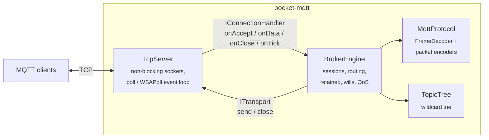

<div align="center">

# pocket-mqtt-broker

**A zero-dependency MQTT 3.1.1 broker in modern C++17. Small enough to read in an afternoon.**

[](https://github.com/erencicekk25/pocket-mqtt-broker/actions/workflows/ci.yml)


[](LICENSE)

[English](#english) · [Türkçe](#türkçe)

</div>

```text
$ ./build/pocket-mqtt --stats 60
12:41:07.512 INFO  server  listening on mqtt://0.0.0.0:1883  (Ctrl+C to stop)
12:41:09.020 INFO  broker  client 'kitchen-sensor' connected from 192.168.1.40:51022 (clean session: yes, keep-alive: 60s)
12:41:09.355 INFO  broker  client 'dashboard' connected from 192.168.1.12:60110 (clean session: no, keep-alive: 30s)
12:41:09.356 INFO  broker  'dashboard' subscribed to 'sensors/+/temp' (QoS 1)
12:42:15.901 INFO  broker  client 'kitchen-sensor' disconnected (connection lost)
12:42:15.901 INFO  broker  publishing will of 'kitchen-sensor' to 'sensors/kitchen/status'
```

---

## English

### Why?

Most MQTT brokers are either production systems with large codebases, or toy examples that
stop at "parse CONNECT". **pocket-mqtt-broker** sits in between. It is a real broker that
speaks standard MQTT 3.1.1, so any compliant client can connect (interoperability is
verified against [MQTT.js](https://github.com/mqttjs/MQTT.js)). The whole broker is under
3,000 lines of commented C++17 with **no third-party code at all**: no Boost, no Asio, no
OpenSSL. Only the standard library and the operating system's sockets.

Good uses:

- 🏠 a lightweight broker for a home lab, a Raspberry Pi or an IoT prototype
- 📚 learning how MQTT actually works on the wire, packet by packet
- 🧩 a small, hackable base for your own broker experiments (auth, bridges, persistence...)

### Features

| | |
|---|---|
| **Protocol** | MQTT 3.1.1 (protocol level 4): CONNECT, PUBLISH, SUBSCRIBE, UNSUBSCRIBE, PING, DISCONNECT and all acknowledgements |
| **Quality of Service** | QoS 0 and QoS 1 end to end; inbound QoS 2 handshake (PUBREC/PUBREL/PUBCOMP) with exactly-once routing |
| **Topics** | `+` and `#` wildcards via a topic trie, `$SYS`-style topics hidden from root wildcards |
| **Sessions** | Clean and persistent sessions, offline QoS 1 queueing, in-flight window, re-delivery with DUP |
| **Messages** | Retained messages (set and clear), Last Will and Testament |
| **Robustness** | Keep-alive enforcement (1.5×), CONNECT timeout, client-id takeover, strict packet validation, max packet size, slow-consumer protection |
| **Portability** | Linux, macOS, Windows (`poll()` / `WSAPoll()`), GCC, Clang, MSVC, MinGW |
| **DX** | Colored logs (honors `NO_COLOR`), clear CLI, built-in load generator, 36 unit tests, CI with sanitizers |

### Quick start

```sh
git clone https://github.com/erencicekk25/pocket-mqtt-broker.git
cd pocket-mqtt-broker
cmake -S . -B build -DCMAKE_BUILD_TYPE=Release
cmake --build build --config Release
./build/pocket-mqtt            # listens on 0.0.0.0:1883
```

On Windows with Visual Studio generators the binaries are placed in `build/Release/`.

Try it with any MQTT client, for example the Mosquitto command-line tools:

```sh
mosquitto_sub -h 127.0.0.1 -t 'sensors/+/temp' -q 1 -v
mosquitto_pub -h 127.0.0.1 -t 'sensors/kitchen/temp' -m '21.5' -q 1
mosquitto_pub -h 127.0.0.1 -t 'status/door' -m 'open' -r   # retained
```

### Command-line options

```text
  -b, --bind <address>        IPv4 address to listen on        (default: 0.0.0.0)
  -p, --port <port>           TCP port, 0 picks a free one      (default: 1883)
      --max-connections <n>   Concurrent connection limit       (default: 10000)
      --max-packet-size <n>   Largest accepted packet in bytes  (default: 1048576)
      --max-queued <n>        QoS 1 messages queued per session (default: 1000)
      --max-inflight <n>      Unacked QoS 1 messages per client (default: 32)
      --stats <seconds>       Log broker statistics periodically (default: off)
  -v, --verbose               Debug logging, including every PUBLISH
  -q, --quiet                 Only log warnings and errors
      --no-color              Disable colored output (NO_COLOR is honored too)
```

### Architecture



| Module | Responsibility |
|---|---|
| [`TcpServer`](include/TcpServer.hpp) | Owns sockets (RAII `Socket`, `NetworkRuntime`), accepts connections, reads and buffers writes. Knows nothing about MQTT. |
| [`MqttProtocol`](include/MqttProtocol.hpp) | Pure codec: `FrameDecoder` turns a fragmented byte stream into `std::variant` packets; encoders produce wire bytes. No I/O, no globals. |
| [`TopicTree`](include/TopicTree.hpp) | Subscription index as a trie of topic levels, plus filter/name validation and a reference matcher. |
| [`BrokerEngine`](include/BrokerEngine.hpp) | The broker logic: CONNECT handling, sessions, QoS flows, retained messages, wills, keep-alive. |
| [`Logger`](include/Logger.hpp) | Thread-safe, colored, single-line log output. |
| [`main.cpp`](src/main.cpp) | CLI parsing, signal handling, wiring. |

### Design decisions

- **One thread, zero locks.** All broker state is touched only from the event loop. That
  removes every mutex from the hot path and every data race by construction. MQTT
  brokers are usually I/O-bound, and a single core already moves millions of messages per
  second (see below).
- **Transport-agnostic engine.** `BrokerEngine` talks to the network only through two small
  interfaces, `ITransport` and `IConnectionHandler`. The unit tests drive the full broker
  through an in-memory fake transport: no sockets, no sleeps, no flakiness.
- **A trie for subscriptions.** Matching a topic walks only the `exact`, `+` and `#` branches
  of each level, so routing cost depends on topic depth and matches, not on the total number
  of subscriptions. Empty branches are pruned on unsubscribe.
- **Encode once, fan out many.** A PUBLISH is encoded at most once per QoS level per routing
  call. For QoS 1 only the two packet-identifier bytes are patched per subscriber. Payloads
  are shared between queues through `std::shared_ptr<const Message>`, never copied.
- **Bounded everything.** Packet size, per-session queue, in-flight window and the per-socket
  outbound buffer are all capped, so a misbehaving or slow client cannot exhaust memory.
  Slow consumers are disconnected instead of being buffered forever.
- **Validate at the edge.** The decoder enforces the spec's MUST rules (reserved flags,
  UTF-8 well-formedness, wildcard placement, packet direction...) before anything reaches
  the engine, and rejects oversized packets from the fixed header alone, before the body
  is buffered.
- **RAII all the way down.** There is no `new`/`delete` in the codebase. Sockets, Winsock
  initialization, buffers and sessions are owned by objects with well-defined lifetimes.
  CI runs the unit tests and a full load test under AddressSanitizer, LeakSanitizer and
  UBSan, and fails on any leak at shutdown.

### Benchmarks

Measured with the bundled [`mqtt-bench`](tools/mqtt_bench.cpp) on a laptop:
Intel Core Ultra 7 255U (14 threads), 16 GB RAM, Windows 11, MinGW-w64 GCC 16 `-O3`.
Broker and clients ran on the same machine over loopback, sharing the same CPU.
Each number is the range over 2–3 runs.

| Scenario | Broker input | Broker output |
|---|---:|---:|
| QoS 0, 64 B payload, 4 publishers → 4 subscribers (fan-out ×4) | 1.5 – 2.1 M msg/s | 5.9 – 8.3 M msg/s |
| QoS 0, 64 B payload, 1 publisher → 1 subscriber | 2.6 M msg/s | 2.6 M msg/s |
| QoS 1, 64 B payload, 4 publishers → 4 subscribers (all acked) | 134k – 147k msg/s | 535k – 589k msg/s |

| Round-trip latency (publish → delivery, one message in flight) | p50 | p99 |
|---|---:|---:|
| QoS 0 | 23 – 51 µs | 84 – 175 µs |
| QoS 1 | 73 µs | 242 µs |

Idle footprint: **~1 MB private memory**, 345 KB executable.

Please read these numbers with care. Loopback has no real network cost, and the benchmark
publishers coalesce 32 packets per `send()` call to keep the client from being the
bottleneck. Results also vary run to run on a laptop. To compare, run the same tool against
any MQTT 3.1.1 broker (mosquitto, EMQX, ...) on your own hardware:

```sh
./build/pocket-mqtt --quiet --max-queued 1000000 &
./build/mqtt-bench --messages 200000                          # QoS 0 throughput
./build/mqtt-bench --qos 1 --messages 50000                   # QoS 1 throughput
./build/mqtt-bench --mode latency --messages 20000            # round-trip latency
./build/mqtt-bench --help
```

### Testing

```sh
ctest --test-dir build -C Release --output-on-failure

# Sanitizer build (GCC/Clang)
cmake -S . -B build-asan -DCMAKE_BUILD_TYPE=Debug -DPOCKET_MQTT_SANITIZE=ON
cmake --build build-asan && ctest --test-dir build-asan
```

The test suite has its own dependency-free harness ([`tests/TestFramework.hpp`](tests/TestFramework.hpp))
and covers the codec (boundary values, fragmentation, malformed input), the topic trie
(cross-checked against the reference matcher) and the broker engine (QoS flows, retained
messages, wills, takeover, persistent sessions, keep-alive, protocol violations).

### Project layout

```text
include/   public headers: TcpServer, MqttProtocol, TopicTree, BrokerEngine, Logger, Transport
src/       implementation + main.cpp (CLI)
tests/     unit tests with a tiny built-in test harness
tools/     mqtt-bench load generator
```

### Limitations and roadmap

These are deliberate scope limits for now, not hidden surprises:

- **No TLS and no authentication yet.** Username and password are parsed but not checked.
  Run it on a trusted network, or behind a TLS-terminating proxy such as stunnel or nginx.
- **Outbound QoS is capped at 1.** QoS 2 subscriptions are granted QoS 1, which the spec
  allows. Inbound QoS 2 is fully supported.
- **Sessions live in memory.** Persistent sessions survive client reconnects, not broker restarts.
- **MQTT 3.1.1 only**, IPv4 only, single-threaded.

Ideas for contributions: MQTT 5, WebSocket transport, `$SYS` statistics topics, an
authentication hook, IPv6, an `epoll`/`kqueue` backend, on-disk persistence.

### Contributing

Issues and pull requests are welcome. Please keep the zero-dependency rule, add a test for
behavior changes, and make sure `ctest` passes with `-DPOCKET_MQTT_WARNINGS_AS_ERRORS=ON`.

### License

[MIT](LICENSE) © 2026 Eren Çiçek

---

## Türkçe

### Neden?

MQTT broker'ları genelde ya devasa kod tabanına sahip üretim sistemleri oluyor ya da
"CONNECT paketini ayrıştırdık" noktasında biten oyuncak örnekler. **pocket-mqtt-broker**
ikisinin arasında duruyor. Standart MQTT 3.1.1 konuşan gerçek bir broker, yani uyumlu her
istemci bağlanabilir (birlikte çalışabilirlik MQTT.js ile doğrulandı). Yine de broker'ın
tamamı 3.000 satırın altında, yorumlu ve okunabilir C++17 kodu ve **hiçbir harici kütüphane
kullanmıyor**: Boost yok, Asio yok, OpenSSL yok. Sadece standart kütüphane ve işletim
sisteminin soketleri.

Nerelerde işe yarar?

- 🏠 Ev laboratuvarı, Raspberry Pi veya IoT prototipleri için hafif bir broker olarak
- 📚 MQTT'nin kablo üzerinde paket paket nasıl çalıştığını öğrenmek için
- 🧩 Kendi broker denemeleriniz (kimlik doğrulama, köprüleme, kalıcılık...) için küçük ve
  kurcalanabilir bir temel olarak

### Özellikler

- **MQTT 3.1.1** (protokol seviyesi 4): CONNECT, PUBLISH, SUBSCRIBE, UNSUBSCRIBE, PING,
  DISCONNECT ve tüm onay paketleri
- **QoS 0 ve QoS 1** uçtan uca; gelen QoS 2 için PUBREC/PUBREL/PUBCOMP el sıkışması ve
  mesajın yalnızca bir kez yönlendirilmesi
- **Joker karakterli abonelikler** (`sensors/+/temp`, `home/#`), trie (önek ağacı) tabanlı
  eşleştirme ve `$SYS` gibi konuların kök jokerlerden gizlenmesi
- **Temiz ve kalıcı oturumlar**, çevrimdışı istemciler için QoS 1 kuyruğu, yeniden
  bağlanınca DUP bayrağıyla tekrar gönderim
- **Retained mesajlar** ve **Last Will** (vasiyet) mesajları
- **Dayanıklılık**: keep-alive denetimi, CONNECT zaman aşımı, aynı client-id ile oturum
  devralma, katı paket doğrulama, maksimum paket boyutu, yavaş istemci koruması
- **Taşınabilirlik**: Linux, macOS ve Windows; GCC, Clang, MSVC ve MinGW

### Hızlı başlangıç

```sh
git clone https://github.com/erencicekk25/pocket-mqtt-broker.git
cd pocket-mqtt-broker
cmake -S . -B build -DCMAKE_BUILD_TYPE=Release
cmake --build build --config Release
./build/pocket-mqtt            # 0.0.0.0:1883 adresini dinler
```

Herhangi bir MQTT istemcisiyle deneyebilirsiniz:

```sh
mosquitto_sub -h 127.0.0.1 -t 'sensors/+/temp' -q 1 -v
mosquitto_pub -h 127.0.0.1 -t 'sensors/kitchen/temp' -m '21.5' -q 1
```

Tüm seçenekler için `./build/pocket-mqtt --help` komutunu çalıştırın.

### Mimari ve tasarım kararları

Proje dört bağımsız modülden oluşuyor:

- **`TcpServer`**: Non-blocking soketler ve `poll()` / `WSAPoll()` tabanlı olay döngüsü. Soket
  tanıtıcıları RAII ile yönetiliyor. Bu katman MQTT hakkında hiçbir şey bilmiyor.
- **`MqttProtocol`**: Saf bir codec. `FrameDecoder`, TCP'den parça parça gelen baytları
  `std::variant` tipinde paketlere dönüştürüyor. Ne I/O yapıyor ne de global durum tutuyor.
- **`TopicTree`**: Abonelikleri konu seviyelerine göre bir trie'de saklıyor. Bir mesajı
  yönlendirmenin maliyeti toplam abonelik sayısına değil, konunun derinliğine bağlı.
- **`BrokerEngine`**: Oturumlar, QoS akışları, retained mesajlar, vasiyetler ve keep-alive.
  Ağa yalnızca iki küçük arayüz (`ITransport`, `IConnectionHandler`) üzerinden erişiyor.
  Bu sayede testler broker'ı gerçek soket açmadan, bellek içi sahte bir transport ile
  uçtan uca çalıştırabiliyor.

Öne çıkan kararlar:

- **Tek iş parçacığı, sıfır kilit.** Broker'ın tüm durumu yalnızca olay döngüsünden
  değiştiriliyor. Böylece sıcak yolda hiç mutex yok ve veri yarışları en baştan imkânsız.
- **Bir kez kodla, çok kişiye gönder.** Bir PUBLISH paketi her QoS seviyesi için en fazla
  bir kez kodlanıyor. QoS 1'de her abone için yalnızca iki baytlık paket kimliği
  güncelleniyor. Yükler (payload) kopyalanmıyor, `shared_ptr` ile paylaşılıyor.
- **Her şey sınırlı.** Paket boyutu, oturum kuyruğu, in-flight penceresi ve soket başına
  gönderim tamponu üst sınırlarla korunuyor. Kötü niyetli ya da yavaş bir istemci belleği
  tüketemiyor.
- **Sıfır bellek sızıntısı.** Kodda tek bir `new`/`delete` yok. CI, testleri ve gerçek
  soketlerle yapılan bir yük testini AddressSanitizer, LeakSanitizer ve UBSan altında
  çalıştırıyor ve kapanışta en ufak sızıntıda kırmızıya dönüyor.

### Performans

Ölçümler, projeyle birlikte gelen `mqtt-bench` aracıyla bir dizüstü bilgisayarda yapıldı
(Intel Core Ultra 7 255U, Windows 11, broker ve istemciler aynı makinede, loopback
üzerinden):

- **QoS 0**, 4 yayıncı → 4 abone: saniyede yaklaşık **1,5 – 2,1 milyon** mesaj girişi ve
  **5,9 – 8,3 milyon** mesaj çıkışı
- **QoS 1**, tüm mesajlar onaylı: saniyede yaklaşık **135 – 147 bin** giriş, **535 – 589 bin** çıkış
- **Gecikme** (QoS 0, tek mesaj): p50 yaklaşık **23 – 51 µs**, p99 yaklaşık **84 – 175 µs**
- Boştayken yaklaşık **1 MB** özel bellek, 345 KB çalıştırılabilir dosya

Bu rakamlar loopback üzerinde ve aynı işlemciyi paylaşan istemcilerle alındı. Gerçek ağda
sonuçlar farklı olacaktır. Kendi donanımınızda herhangi bir MQTT 3.1.1 broker'ına karşı aynı
aracı çalıştırıp karşılaştırabilirsiniz (komutlar için İngilizce bölümdeki *Benchmarks*
kısmına bakın).

### Sınırlamalar

- Henüz **TLS ve kimlik doğrulama yok**. Kullanıcı adı ve parola ayrıştırılıyor ama kontrol
  edilmiyor. Güvenilir bir ağda ya da TLS sonlandıran bir proxy'nin arkasında kullanın.
- Abonelere giden mesajlarda QoS en fazla 1. Spesifikasyon buna izin veriyor.
- Oturumlar bellekte tutuluyor. Broker yeniden başlatılınca kalıcı oturumlar kayboluyor.
- Yalnızca MQTT 3.1.1 ve IPv4 destekleniyor.

### Katkı

Issue ve pull request'ler memnuniyetle karşılanır. Lütfen sıfır bağımlılık kuralını koruyun,
davranış değişiklikleri için test ekleyin ve `ctest` komutunun
`-DPOCKET_MQTT_WARNINGS_AS_ERRORS=ON` ile geçtiğinden emin olun.

### Lisans

[MIT](LICENSE) © 2026 Eren Çiçek
